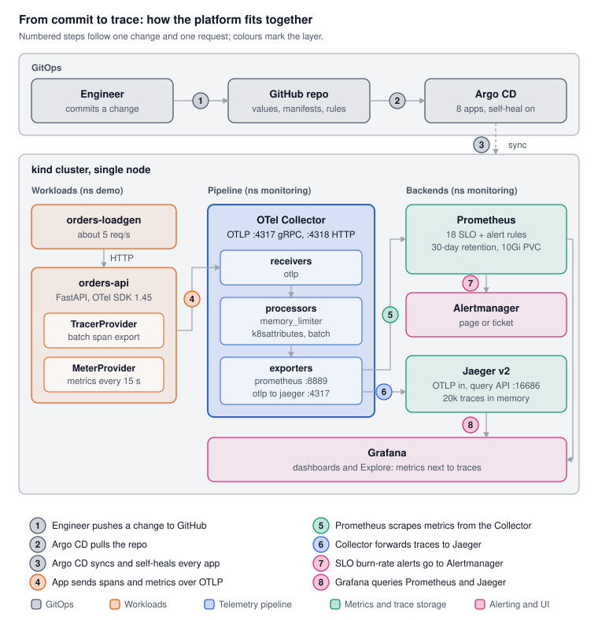

# Building a Production-Style SRE Platform on Kubernetes

**Observability, SLOs, GitOps and tracing, end to end, on a laptop-sized cluster.**



## Project overview

I built a small but production-shaped reliability platform on a local Kubernetes cluster: an OpenTelemetry-instrumented service, metrics and traces flowing through an OTel Collector, SLOs with multi-window burn-rate alerts, and the whole stack managed by Argo CD from Git.

**Stack:** kind · Prometheus · Grafana · Alertmanager · OpenTelemetry (SDK + Collector) · Jaeger · Argo CD · Helm · Kustomize · Python/FastAPI · promtool

**What it does, in numbers (measured in the lab):**

- **9 Argo CD Applications** deploy everything from this repo. `helm list` is empty: Git is the only source of truth.
- **2 SLOs** on one user journey: availability 99.5% and latency 99% under 250 ms, over a 30-day window.
- **18 Prometheus rules** (SLIs over 6 windows, error budget, 2 burn-rate alerts), covered by **4 promtool unit-test scenarios**.
- **21/21 scrape targets up**, about **7 spans/s**, and every request traced end to end across two services in Jaeger and Grafana.
- An **incident drill run through Git**: a commit injected 10% errors, and the page fired **26.5 minutes** later with the failing span visible in Jaeger.

## Contents

1. [Architecture](#architecture)
2. [Tech stack](#tech-stack)
3. [Step 1: Kubernetes lab and monitoring foundation](#step-1-kubernetes-lab-and-monitoring-foundation)
4. [Step 2: OpenTelemetry Collector as the telemetry gateway](#step-2-opentelemetry-collector-as-the-telemetry-gateway)
5. [Step 3: Instrumenting a service with the OpenTelemetry SDK](#step-3-instrumenting-a-service-with-the-opentelemetry-sdk)
6. [Step 4: SLOs, error budgets and burn-rate alerting](#step-4-slos-error-budgets-and-burn-rate-alerting)
7. [Step 5: GitOps with Argo CD](#step-5-gitops-with-argo-cd)
8. [Step 6: Distributed tracing with Jaeger and Grafana](#step-6-distributed-tracing-with-jaeger-and-grafana)
9. [Step 7: End-to-end incident drill, run through Git](#step-7-end-to-end-incident-drill-run-through-git)
10. [Step 8: A second service and cross-service tracing](#step-8-a-second-service-and-cross-service-tracing)
11. [Real problems and how they were debugged](#real-problems-and-how-they-were-debugged)
12. [What I would change for production](#what-i-would-change-for-production)
13. [Run it yourself](#run-it-yourself)

## Architecture

The diagram above follows one change and one request through the system:

| Step | What happens |
| --- | --- |
| 1 | An engineer pushes a change to GitHub |
| 2 | Argo CD pulls the repo |
| 3 | Argo CD syncs and self-heals every component, including itself |
| 4 | orders-api and inventory-api send spans and metrics to the OTel Collector over OTLP |
| 5 | Prometheus scrapes the app's metrics from the Collector |
| 6 | The Collector forwards traces to Jaeger |
| 7 | Prometheus evaluates the SLO rules and sends burn-rate alerts to Alertmanager |
| 8 | Grafana queries Prometheus and Jaeger side by side |

Both services talk only to the Collector, and orders-api calls inventory-api with a W3C `traceparent` header, so each request is one trace across both. The Collector enriches everything with Kubernetes metadata and fans it out, so backends can change without touching application code. podinfo (not drawn) is a second workload scraped by Prometheus directly.

## Tech stack

Every chart and image is pinned to an exact version, so the lab rebuilds identically.

| Component | Version | Role |
| --- | --- | --- |
| kind (Kubernetes) | v1.37.0, single node | Local cluster |
| kube-prometheus-stack | chart 92.11.0 (Prometheus 3.15.0, Grafana 13.2.4) | Metrics, alerting, dashboards, Prometheus Operator |
| OpenTelemetry Collector (contrib) | chart 0.177.0, collector 0.163.2 | Telemetry gateway: OTLP in, Prometheus and Jaeger out |
| OpenTelemetry Python SDK | 1.45.1 (FastAPI and httpx instrumentation 0.66b1) | Traces and metrics from the app |
| Jaeger | chart 4.13.1, Jaeger 2.20.0 | Trace storage and UI |
| Argo CD | chart 10.11.1, Argo CD 3.5.6 | GitOps: deploys and self-heals everything |
| orders-api, inventory-api | FastAPI 0.162.0 on Python 3.13, httpx 0.28.1 | Two sample services (orders-api calls inventory-api), failure injection in each |
| podinfo | chart 6.15.0 | Second sample workload for scraping |
| promtool | 3.15.0 | Unit tests for alert and recording rules |

## Step 1: Kubernetes lab and monitoring foundation

A single-node kind cluster runs the whole platform. kube-prometheus-stack gives Prometheus, Alertmanager, Grafana and the Prometheus Operator in one install.

**1.1 Cluster**

```bash
kind create cluster --name local-k8s
kubectl get nodes   # local-k8s-control-plane   Ready   v1.37.0
```

**1.2 kube-prometheus-stack** (later moved under Argo CD, see Step 5). Three values decisions mattered:

```yaml
# lab/helm/kube-prometheus-stack-values.yaml (excerpt)
kubeEtcd: { enabled: false }               # kind binds these to 127.0.0.1:
kubeControllerManager: { enabled: false }  # scrapes always fail and
kubeScheduler: { enabled: false }          # fire false alerts
kubeProxy: { enabled: false }

prometheus:
  prometheusSpec:
    serviceMonitorSelectorNilUsesHelmValues: false  # pick up monitors
    podMonitorSelectorNilUsesHelmValues: false      # and rules from
    ruleSelectorNilUsesHelmValues: false            # any namespace
    retention: 30d                                  # needed for a 30-day SLO window
    storageSpec:
      volumeClaimTemplate:
        spec: { resources: { requests: { storage: 10Gi } } }
```

- **Disabled control-plane scrapes:** on kind these components listen on localhost only, so they would page forever for a non-problem.
- **Open selectors:** by default the operator only reads `PrometheusRule` and `ServiceMonitor` objects labelled with its Helm release. Opening them lets each app team ship its own monitoring next to its code.
- **30-day retention on a persistent volume:** the SLO window is 30 days, and data must survive pod restarts.

**1.3 podinfo** as a first scrape target, with `serviceMonitor.enabled: true`. Verified that `/metrics` responds and that Prometheus shows both pods as `up`.

**Result:** Prometheus, Grafana and Alertmanager running in `monitoring`; podinfo in `demo`, scraped every 15 s.

## Step 2: OpenTelemetry Collector as the telemetry gateway

Apps send everything to one OTLP endpoint. The Collector enriches it with Kubernetes metadata and fans it out, so backends can change without touching app code.

**Design:** one Collector Deployment (contrib image, needed for the Prometheus exporter and `k8sattributes`), OTLP in on 4317 (gRPC) and 4318 (HTTP), Jaeger and Zipkin receivers switched off.

```yaml
# lab/helm/otel-collector-values.yaml (excerpt)
mode: deployment
image: { repository: otel/opentelemetry-collector-contrib }
presets:
  kubernetesAttributes: { enabled: true }   # adds k8s.pod.name, k8s.deployment.name, ...
resources:
  limits: { cpu: 500m, memory: 512Mi }      # gives memory_limiter a real limit
config:
  exporters:
    prometheus: { endpoint: ${env:MY_POD_IP}:8889, send_timestamps: true }
    otlp/jaeger: { endpoint: jaeger.monitoring.svc:4317, tls: { insecure: true } }
  service:
    pipelines:
      metrics: { receivers: [otlp], processors: [memory_limiter, k8sattributes, batch], exporters: [prometheus] }
      traces:  { receivers: [otlp], processors: [memory_limiter, k8sattributes, batch], exporters: [otlp/jaeger] }
      logs:    { receivers: [otlp], processors: [memory_limiter, k8sattributes, batch], exporters: [debug] }
serviceMonitor:
  enabled: true   # scrapes :8888 (collector health) and :8889 (app metrics)
```

**Verification:** a smoke test from inside the cluster posted one OTLP metric and one span with `curl`. The metric showed up in Prometheus as `smoke_test_requests_total = 42`, and the span appeared in the Collector output.

**Collector health metrics** to alert on in production (no `_total` suffix in this version):

```promql
sum(rate(otelcol_receiver_accepted_spans[5m]))   # spans in
sum(rate(otelcol_exporter_sent_spans[5m]))       # spans out
sum(rate(otelcol_receiver_refused_spans[5m]))    # refused, e.g. memory_limiter
```

**A detail worth knowing:** Prometheus scrapes the Collector, not the app, so `job`, `namespace` and `pod` on app metrics belong to the Collector. The app's identity is `exported_job="demo/orders-api"`, and its pod metadata lives on `target_info`, joined like this:

```promql
sum by (k8s_pod_name) (
  rate(http_server_request_duration_seconds_count{exported_job="demo/orders-api",http_response_status_code=~"5.."}[5m])
  * on (exported_job, exported_instance) group_left(k8s_pod_name) target_info
)
```

## Step 3: Instrumenting a service with the OpenTelemetry SDK

`orders-api` is a small FastAPI service set up with the OTel SDK explicitly (providers, exporters, resource) rather than zero-code auto-instrumentation, so every piece of the pipeline is visible and explainable.

```python
# lab/apps/orders-api/app.py (excerpt)
resource = Resource.create({"service.version": os.getenv("APP_VERSION", "0.1.0")})

tracer_provider = TracerProvider(resource=resource)
tracer_provider.add_span_processor(BatchSpanProcessor(OTLPSpanExporter()))
trace.set_tracer_provider(tracer_provider)

meter_provider = MeterProvider(resource=resource, metric_readers=[
    PeriodicExportingMetricReader(OTLPMetricExporter(), export_interval_millis=15000)])
metrics.set_meter_provider(meter_provider)

orders_processed = meter.create_counter("orders.processed", unit="{order}")

@app.get("/orders/{order_id}")
def get_order(order_id: int):
    with tracer.start_as_current_span("db.lookup_order") as span:
        span.set_attribute("order.id", order_id)
        time.sleep(random.uniform(0.005, 0.03) + extra_latency_ms / 1000)
        if random.random() < error_rate:
            orders_processed.add(1, {"outcome": "error"})
            raise HTTPException(status_code=500, detail="injected failure")
    orders_processed.add(1, {"outcome": "ok"})
    return {"order_id": order_id, "status": "shipped"}

# /healthz excluded so probe traffic never counts toward the SLI
FastAPIInstrumentor.instrument_app(app, excluded_urls="healthz", meter_provider=meter_provider)
```

**What it emits:**

| Signal | Source | Seen as |
| --- | --- | --- |
| HTTP latency histogram | FastAPI instrumentation, stable semconv | `http_server_request_duration_seconds_{bucket,count,sum}` |
| Orders by outcome | Custom counter `orders.processed` | `orders_processed_total{outcome}` |
| Traces | Server span + child `db.lookup_order` | Jaeger service `orders-api` |

**Configuration by standard env vars**, so the same code runs anywhere:

```yaml
- { name: OTEL_SERVICE_NAME, value: orders-api }
- { name: OTEL_RESOURCE_ATTRIBUTES, value: "service.namespace=demo,deployment.environment.name=lab" }
- { name: OTEL_EXPORTER_OTLP_ENDPOINT, value: "http://otel-opentelemetry-collector.monitoring.svc:4318" }
- { name: OTEL_SEMCONV_STABILITY_OPT_IN, value: http }   # seconds-based stable HTTP metrics
- { name: ERROR_RATE, value: "0" }                       # failure injection knobs
- { name: EXTRA_LATENCY_MS, value: "0" }
```

**Deployment without an image build:** the cluster host had no local Docker, so the code ships in a Kustomize-generated ConfigMap and an init container installs pinned dependencies on `python:3.13.17-slim`. The ConfigMap's hash suffix rolls the pods whenever `app.py` changes. A `Dockerfile` is included for a proper image build.

**Load generator:** a tiny curl Deployment sends about 5 requests/s, so SLIs always have data.

## Step 4: SLOs, error budgets and burn-rate alerting

The alerting pages on how fast the error budget is burning, not on raw error counts, so a short blip stays quiet while a real outage wakes someone up within minutes.

**4.1 SLIs and SLOs** for one user journey, `GET /orders/{order_id}`, over a rolling 30 days:

| SLO | Good event | Target | Error budget |
| --- | --- | --- | --- |
| Availability | Request did not return 5xx | 99.5% | 0.5% (about 64,800 failed requests a month at 5 req/s) |
| Latency | Request served in 250 ms or less | 99% | 1% |

250 ms sits exactly on a histogram bucket boundary (`le="0.25"`), so the latency SLI is an exact count, not an interpolated percentile.

**4.2 Recording rules:** each SLI's error ratio is recorded over 5m, 30m, 1h, 6h, 3d and 30d, labelled `service` and `slo`, so the same two alerts serve both SLOs.

```promql
# slo:sli_error:ratio_rate{W}{slo="availability"}
(sum(rate(http_server_request_duration_seconds_count{exported_job="demo/orders-api",http_route="/orders/{order_id}",http_response_status_code=~"5.."}[W])) or vector(0))
/
sum(rate(http_server_request_duration_seconds_count{exported_job="demo/orders-api",http_route="/orders/{order_id}"}[W]))
```

`or vector(0)` keeps the series at 0 before the first 5xx ever happens, instead of returning nothing.

**4.3 Multi-window, multi-burn-rate alerts** ([Google SRE Workbook](https://sre.google/workbook/alerting-on-slos/)). Burn rate is the observed error ratio divided by the budget; 1x spends exactly the budget in 30 days.

| Alert | Burn rate | Long window | Short window | Budget spent when it fires |
| --- | --- | --- | --- | --- |
| Page | 14.4x | 1h | 5m | 2% |
| Page | 6x | 6h | 30m | 5% |
| Ticket | 1x | 3d | 6h | 10% |

```yaml
- alert: SLOErrorBudgetBurnPage
  expr: |
    (
        slo:sli_error:ratio_rate1h > (14.4 * slo:error_budget:ratio)
      and
        slo:sli_error:ratio_rate5m > (14.4 * slo:error_budget:ratio)
    )
    or
    (
        slo:sli_error:ratio_rate6h > (6 * slo:error_budget:ratio)
      and
        slo:sli_error:ratio_rate30m > (6 * slo:error_budget:ratio)
    )
  labels: { severity: critical, notify: page }
```

- **The long window** gives significance: a two-minute blip does not page.
- **The short window** gives fast reset: the alert clears soon after the problem stops.
- **Slow burns become tickets,** handled in working hours instead of at 3 a.m.

**4.4 Tested like code.** `promtool test rules` runs 4 scenarios against synthetic traffic (300 requests/min):

1. Healthy traffic: no alerts, budget at 100%.
2. 10% errors for 1 hour: page.
3. 1% errors for 3 days: ticket, never a page.
4. 10% of requests slower than 250 ms: latency page, availability unaffected.

```console
$ promtool test rules lab/slo/orders-api-slo.test.yaml
  SUCCESS
```

**4.5 Error budget policy** turns the numbers into decisions agreed in advance ([full policy](error-budget-policy.md), [SLO doc](slo.md)):

| Budget left (30d) | State | What happens |
| --- | --- | --- |
| Over 50% | Healthy | Normal releases; room for experiments and chaos tests |
| 25–50% | Caution | Weekly review of top error sources; smaller, reversible changes |
| 0–25% | At risk | Low-risk releases only; an engineer on reliability work |
| 0% or less | Freeze | Feature releases stop; postmortem required |

## Step 5: GitOps with Argo CD

After one bootstrap `helm install`, every component, including Argo CD itself, is deployed, upgraded and self-healed from Git. A `kubectl edit` is reverted within minutes.

**5.1 Bootstrap, once:**

```bash
helm install argocd argo/argo-cd --version 10.11.1 -n argocd --create-namespace -f lab/helm/argocd-values.yaml
kubectl apply -f lab/argocd/root.yaml     # app of apps
```

**5.2 App of apps.** `root` syncs [`lab/argocd/apps/`](../lab/argocd/apps), which holds every Application and two AppProjects:

| Application | Source | Project |
| --- | --- | --- |
| argocd | argo/argo-cd 10.11.1 + values from Git | platform |
| kube-prometheus-stack | prometheus-community chart 92.11.0 + values | platform |
| otel-collector | open-telemetry chart 0.177.0 + values | platform |
| jaeger | jaegertracing chart 4.13.1 + values | platform |
| orders-api-slo | `lab/slo/k8s/` (PrometheusRule) | platform |
| podinfo | podinfo chart 6.15.0 + values | sre-lab |
| orders-api | `lab/apps/orders-api/` (Kustomize) | sre-lab |
| inventory-api | `lab/apps/inventory-api/` (Kustomize) | sre-lab |

- **Multi-source Applications:** the chart comes from its Helm repo at a pinned version; the values file comes from this repo through a `$values` reference.
- **Two AppProjects as guardrails:** `platform` may create cluster-scoped objects (CRDs, ClusterRoles, webhooks). `sre-lab` is locked to the `demo` namespace and its own Namespace object.
- **Sync options that mattered:** `ServerSideApply=true` (the Prometheus Operator CRDs exceed the 256 KB annotation limit of client-side apply), `ignoreDifferences` on webhook `caBundle` fields injected at runtime, `CreateNamespace=true`, and sync waves so projects and CRDs land first.
- **Argo CD manages itself** with self-heal on and prune off, so a bad render can never delete Argo CD's own components.

```yaml
# lab/argocd/apps/kube-prometheus-stack.yaml (excerpt)
sources:
  - repoURL: https://prometheus-community.github.io/helm-charts
    chart: kube-prometheus-stack
    targetRevision: 92.11.0
    helm:
      releaseName: monitoring        # same name as the original Helm release
      valueFiles: [$values/lab/helm/kube-prometheus-stack-values.yaml]
  - repoURL: https://github.com/CloudScope/sre-prep.git
    targetRevision: main
    ref: values
syncPolicy:
  automated: { prune: true, selfHeal: true }
  syncOptions: [CreateNamespace=true, ServerSideApply=true, RespectIgnoreDifferences=true]
```

**5.3 Zero-downtime cutover from Helm.** The stack was first installed with plain Helm. Keeping `releaseName` identical made the rendered names match, so Argo CD **adopted the running objects in place**: the Prometheus pod and its volume were untouched, and over 3 hours of history survived. Then only Helm's bookkeeping was removed:

```bash
kubectl -n monitoring delete secret -l owner=helm,name=monitoring   # not `helm uninstall`,
kubectl -n monitoring delete secret -l owner=helm,name=otel         # which would delete
kubectl -n demo       delete secret -l owner=helm,name=podinfo      # the workloads
kubectl -n argocd     delete secret -l owner=helm,name=argocd
helm list -A   # empty
```

**5.4 SLO rules as GitOps too.** `promtool` only reads plain rule files, so the plain file stays the tested source and [`render.sh`](../lab/slo/render.sh) wraps it into a `PrometheusRule` for Argo CD; `render.sh --check` fails if the committed output is stale.

**Self-heal in practice:** a failure rate set by hand with `kubectl set env` was quietly reset to the Git value. From then on, failure injection is a commit.

## Step 6: Distributed tracing with Jaeger and Grafana

Traces go from the Collector to Jaeger over OTLP gRPC, and Grafana reads them through a Jaeger data source, so metrics and traces sit side by side in one Explore view.

**6.1 Jaeger v2 all-in-one** (Jaeger v2 is itself built on the OpenTelemetry Collector), in-memory storage capped for the lab:

```yaml
# lab/helm/jaeger-values.yaml (excerpt)
jaeger:
  resources: { limits: { cpu: 500m, memory: 512Mi } }
userconfig:
  extensions:
    jaeger_storage:
      backends:
        memstore:
          memory: { max_traces: 20000 }   # oldest evicted past this
  service:
    pipelines:
      traces: { receivers: [otlp], processors: [batch], exporters: [jaeger_storage_exporter] }
```

The config was checked offline with `jaeger validate`, using a checksum-verified Jaeger binary, before it ever reached the cluster.

**6.2 Grafana data source**, provisioned from the kube-prometheus-stack values:

```yaml
grafana:
  additionalDataSources:
    - { name: Jaeger, type: jaeger, uid: jaeger, access: proxy, url: http://jaeger.monitoring.svc:16686 }
```

**6.3 What a trace shows.** One request to orders-api, as stored in Jaeger:

```text
GET /orders/{order_id}          12.7 ms   http.route=/orders/{order_id}  http.response.status_code=200
 └─ db.lookup_order             10.7 ms   order.id=75
resource: service.name=orders-api  service.namespace=demo
          k8s.deployment.name=orders-api  k8s.pod.name=orders-api-6d8f667469-zcl99
```

The `k8s.*` attributes were added by the Collector, not by the app: that is the payoff of a central gateway.

**How to look:**

- **Jaeger UI:** `kubectl -n monitoring port-forward svc/jaeger 16686:16686`, service `orders-api`, Find Traces.
- **Grafana:** Explore, Jaeger data source, Search, service `orders-api`. Split the view to put the Prometheus error ratio next to the traces.

## Step 7: End-to-end incident drill, run through Git

A single commit injected 10% errors into orders-api; every layer of the platform then showed the same incident from its own angle.

**7.1 Inject the failure as a commit,** so the incident has a Git SHA and the fix will too:

```diff
 # lab/apps/orders-api/k8s/deployment.yaml
             - name: ERROR_RATE
-              value: "0"
+              value: "0.1"
```

Pushed at 18:12:56 UTC; Argo CD rolled it out by 18:14:48.

**7.2 Do the burn-rate math before looking at alerts.** 10% errors against a 0.5% budget is a 20x burn. The time for a window to cross its threshold:

```math
t_{\text{detect}} = \text{long window} \times \frac{\text{threshold burn}}{\text{actual burn}} = 60\,\text{min} \times \frac{14.4}{20} \approx 43\,\text{min}
```

So the 1h tier is expected to page about 43 minutes in, after roughly 2% of the monthly budget is gone. A full outage (200x burn) would page in about 4 minutes. This is the trade-off the alert encodes: no page on the first bad minute, a fast page for anything that threatens the month.

**7.3 What each layer showed** in the first minute (snapshot at 18:15 UTC):

| Layer | Signal |
| --- | --- |
| Jaeger | 6 error traces in the first minute; `db.lookup_order` with `error=true` and `HTTPException: 500: injected failure` |
| Prometheus, 5m window | Error ratio rising past 0.6% and climbing toward 10% |
| Prometheus, 1h window | 0.2%: still far from the 7.2% page threshold, as designed |
| Alertmanager | `SLOErrorBudgetBurnTicket` already firing since 18:00:47 from earlier 5% runs, a correct slow-leak signal |

The error trace, as Jaeger stored it:

```text
GET /orders/{order_id}               23.3 ms   http.response.status_code=500  error=true
 └─ db.lookup_order                  20.2 ms   order.id=819  error=true
                                               otel.status_description="HTTPException: 500: injected failure"
```

The exception was recorded on the span automatically, because it was raised inside `tracer.start_as_current_span(...)`.

**7.4 Result: the page fired at 18:41:17 UTC, 26.5 minutes after rollout**, through the 6x tier rather than the 14.4x tier:

| Window | Error ratio | Burn | Threshold | State |
| --- | --- | --- | --- | --- |
| 5m | 9.58% | 19.2x | 14.4x | over |
| 1h | 6.91% | 13.8x | 14.4x | just under |
| 30m | 9.31% | 18.6x | 6x | over |
| 6h | 3.06% | 6.1x | 6x | over: **page** |

The 43-minute estimate was for the 1h tier alone. The 6h window still held earlier hours of 5% errors, so it crossed 3% first. That is the second tier doing its job: catching a burn that has built up over hours, not just a sudden spike. At the same moment Jaeger held 200 error traces from the last 5 minutes, each pointing at `db.lookup_order`.

**7.5 End the drill the same way it started:** `git revert` the commit and push. The 5m window drops below threshold within minutes and the page clears, while the 6h and 3d windows keep a record of what the month cost.

## Step 8: A second service and cross-service tracing

Adding inventory-api behind orders-api turns every request into one trace across two services, and the trace alone shows which service failed.

**What each service does.** The two services model a minimal online-shop backend:

| Service | Role in the shop | Endpoint | Returns |
| --- | --- | --- | --- |
| orders-api | Customer-facing API: look up an order and its status. This is the user journey the SLOs protect | `GET /orders/{order_id}` | `{"order_id": 42, "status": "shipped"}` |
| inventory-api | Internal backend: checks stock for the order's item. Customers never call it directly | `GET /inventory/{item_id}` | `{"item_id": 42, "in_stock": 100}` |

Both are deliberately simple and simulated: the "database" calls are short random sleeps, and the data is generated. Their purpose is to produce realistic telemetry (traffic, latency, own failures and dependency failures) for practising SLOs, alerting and tracing, not to run a real shop.

**How the two services link.** They share no code and no database; two things connect them:

- **The network:** orders-api calls inventory-api by its Kubernetes Service name, `http://inventory-api:8000` (both run in the `demo` namespace; set by `INVENTORY_URL`). The Service load-balances across inventory-api pods.
- **The trace context:** every call carries a W3C `traceparent` header, `00-<trace-id>-<parent-span-id>-01`. orders-api's httpx instrumentation writes it; inventory-api's FastAPI instrumentation reads it and makes its own spans children of the caller's span. Each service exports its spans separately, and Jaeger joins them by the shared trace ID.

**Request flow for one order:**

1. orders-loadgen sends `GET /orders/42` to the orders-api Service.
2. orders-api starts a new trace with a server span, then runs `db.lookup_order` (a simulated 5–30 ms lookup). With its 5% error rate it can fail here: it answers 500 and the flow ends.
3. orders-api calls `GET http://inventory-api:8000/inventory/42` (2 s timeout). httpx records a client span and adds the `traceparent` header.
4. inventory-api continues the same trace: a server span, then `db.check_stock` (2–15 ms). With its own 5% error rate it can answer 500.
5. orders-api answers the caller: **200** `{"order_id": 42, "status": "shipped"}` when inventory said 200, or **502** when inventory returned 5xx or timed out.
6. In the background, both services export spans in batches and metrics every 15 s to the OTel Collector over OTLP. Jaeger assembles the full trace; Prometheus counts each service's requests by status code.

**8.1 Design.** For every order, orders-api calls `GET /inventory/{item_id}`. Each service has its own `ERROR_RATE` knob, and the status code tells failures apart:

| Failure in | orders-api returns | Where the trace turns red |
| --- | --- | --- |
| orders-api | 500 | `db.lookup_order` in orders-api; inventory-api is never called |
| inventory-api | 502 (`outcome="dependency_error"`) | `db.check_stock` in inventory-api, then up through the client span to orders-api |

**8.2 Context propagation is two lines.** Instrumenting httpx makes every outgoing call a client span and adds the W3C `traceparent` header; inventory-api's FastAPI instrumentation reads it, so its spans join the same trace:

```python
# lab/apps/orders-api/app.py (excerpt)
HTTPXClientInstrumentor().instrument()   # before creating the client
inventory = httpx.Client(base_url=os.getenv("INVENTORY_URL", "http://inventory-api:8000"), timeout=2.0)

    try:
        inventory.get(f"/inventory/{order_id % 100}").raise_for_status()
    except httpx.HTTPError as exc:
        orders_processed.add(1, {"outcome": "dependency_error"})
        trace.get_current_span().set_status(trace.StatusCode.ERROR, f"inventory-api: {exc}")
        raise HTTPException(status_code=502, detail="inventory-api failed") from exc
```

**8.3 What the three cases look like in Jaeger** (from the cluster, 5% errors injected in each service):

```text
healthy (200)
  orders-api     GET /orders/{order_id}      200   34.2 ms
    orders-api     db.lookup_order                    7.9 ms
    orders-api     GET  (client span)          200   16.0 ms
      inventory-api  GET /inventory/{item_id}    200   14.9 ms
        inventory-api  db.check_stock                     7.8 ms

failure in orders-api (500): the trace stops here
  orders-api     GET /orders/{order_id}      500  ERROR
    orders-api     db.lookup_order                  ERROR  HTTPException: 500: injected failure

failure in inventory-api (502): the error starts downstream and spreads up
  orders-api     GET /orders/{order_id}      502  ERROR
    orders-api     db.lookup_order                  ok
    orders-api     GET  (client span)          500  ERROR
      inventory-api  GET /inventory/{item_id}    500  ERROR
        inventory-api  db.check_stock                   ERROR  HTTPException: 500: injected failure
```

**8.4 Results:** 257 of the last 300 orders-api traces crossed both services (the rest failed in orders-api before the call). Jaeger's service graph shows the `orders-api → inventory-api` edge, 275 calls in 10 minutes. The orders-api availability SLI counts 502s too, because the user still sees a failed order.

**8.5 Tested before deploying.** Both services and Jaeger 2.20 ran locally first; all three trace shapes appeared before anything was pushed. Then one commit added the code, the manifests and a new Argo CD Application.

## Real problems and how they were debugged

Six things broke along the way; each one is a small production lesson.

| Symptom | Root cause | Fix | Lesson |
| --- | --- | --- | --- |
| `kube-controller-manager` and `kube-scheduler` in CrashLoopBackOff; kubectl timing out | The node VM had 3.8 GiB for etcd, the API server and the whole stack. API calls got slow enough that the controllers lost their leader-election lease ("leaderelection lost") and exited | Raised the WSL2 VM memory (`.wslconfig`) to about 6 GiB; all 27 pods stable since | Control-plane crash loops are often a symptom of API server starvation, not their own bug. Read `--previous` logs first |
| Budget rule: `duplicate sample for timestamp`, then budget-remaining queries returning empty | When Argo CD adopted the `PrometheusRule`, Prometheus reloaded rules and the 5-minute group kept writing results one interval in the past | Deleted the Prometheus pod (not `rollout restart`, whose annotation Argo CD would treat as drift and revert) | Check a series' sample timestamps, not just rule health: "ok" rules can still write stale data |
| Grafana's Jaeger data source: `404 Not Found` | Jaeger 2.21.0 removed the v1 HTTP query API that Grafana's plugin still calls | Pinned Jaeger to 2.20.0 (chart 4.13.1), after proving locally that it serves `/api/services` with the same config | Read release notes for `!` breaking changes; pin versions and write down why |
| Jaeger data source missing in Grafana after a correct sync | The datasource sidecar's reload call got 401: the admin password had been changed in the UI, while the sidecar uses the one in the Secret | Reset the password to match the Secret, triggered the reload | UI-set state silently breaks GitOps provisioning. Keep credentials in one place |
| New Application stuck in `InvalidSpecError: project does not exist` | The app of apps created the Application before its AppProject | `argocd.argoproj.io/sync-wave: "-1"` on projects | Order matters even in declarative systems: use sync waves |
| `promtool`: `did not find expected key` | A YAML block scalar whose first line was indented deeper than the next | Re-indented; rules now pass `promtool check rules` | Lint and unit-test alert rules in CI, like any other code |

## What I would change for production

The design carries over to production unchanged; the lab shortcuts are in storage, availability and security.

| Lab shortcut | Production version |
| --- | --- |
| Single Prometheus with a local volume | HA Prometheus pair + long-term storage (Thanos, Mimir or a managed Prometheus), so the 30-day window survives anything |
| Jaeger in memory | Durable backend (Elasticsearch/OpenSearch, Cassandra) or Grafana Tempo on object storage, with tail sampling in the Collector |
| One Collector Deployment | Agent DaemonSet per node + a horizontally scaled gateway tier; alerts on refused and failed spans |
| SLI measured at the service | Add a load balancer or synthetic-probe SLI, which also catches failures before traffic reaches the pod |
| Plain-text OTLP, admin passwords in values | mTLS between services; SSO for Grafana and Argo CD; secrets from a secret manager |
| Alertmanager with no receivers | Routing to an on-call tool, with a runbook link on every alert |
| Rules tested by hand | `promtool test rules` and `render.sh --check` in CI on every pull request |

**Next steps in this lab:** a runbook and blameless postmortem template for the burn-rate page, a Grafana SLO dashboard, exemplars linking latency spikes to traces, and Argo CD rollback drills.

## Run it yourself

Four commands rebuild the whole platform on a fresh machine with kind, kubectl and Helm; Argo CD does the rest from this repo.

```bash
kind create cluster --name local-k8s
helm repo add argo https://argoproj.github.io/argo-helm
helm install argocd argo/argo-cd --version 10.11.1 -n argocd --create-namespace -f lab/helm/argocd-values.yaml
kubectl apply -f lab/argocd/root.yaml
```

Give the node at least 6 GiB of memory (on Docker Desktop for Windows, `memory=6GB` or more in `.wslconfig`).

**Open the UIs:**

```bash
kubectl -n argocd     port-forward svc/argocd-server 8080:80                          # Argo CD
kubectl -n monitoring port-forward svc/monitoring-grafana 3000:80                     # Grafana
kubectl -n monitoring port-forward svc/monitoring-kube-prometheus-prometheus 9090:9090 # Prometheus
kubectl -n monitoring port-forward svc/jaeger 16686:16686                             # Jaeger
```

**Repository layout:**

```text
lab/
  argocd/root.yaml                app of apps (applied once)
  argocd/apps/                    one Application per component + 2 AppProjects
  helm/                           pinned values for every chart
  apps/orders-api/                FastAPI app, Kustomize manifests, load generator, Dockerfile
  apps/inventory-api/             downstream service called by orders-api
  slo/orders-api-slo.rules.yaml   SLIs, budgets, burn-rate alerts (source of truth)
  slo/orders-api-slo.test.yaml    promtool unit tests
  slo/render.sh                   renders the PrometheusRule into slo/k8s/ for Argo CD
docs/
  project-writeup.md              this document
  slo.md                          SLO document
  error-budget-policy.md          what happens at each budget level
  images/architecture.svg         the diagram above (+ gen_architecture_svg.py)
```
